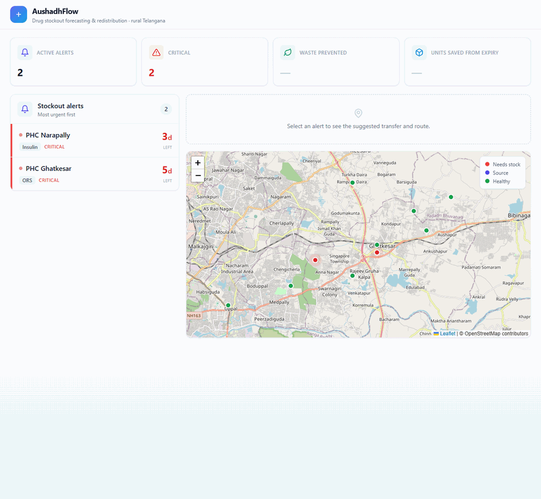

# AushadhFlow

A district-level dashboard that predicts when rural health centres (PHCs and CHCs) will run out of a drug, and suggests moving stock from a nearby centre that has a surplus, ideally one whose batch would expire before it gets used.

For example: PHC Narapally is about 3 days from running out of insulin. CHC Medipally, 3.1 km away, has insulin that expires in 30 days and more than it can use before then. The app suggests sending 104 units from Medipally to Narapally and draws the route on the map. One transfer covers the shortage and keeps the surplus from going to waste.

We built this as a team at the Google WOW 2026 hackathon. It's a prototype that runs entirely in the browser on synthetic data for a simulated rural Telangana district: 10 centres (7 PHCs, 3 CHCs), 8 drugs and 30 days of consumption history for each.



## Features

- **Stockout alerts.** For every centre and drug, estimates days until stock runs out using a trend-adjusted daily rate (0.7 × average of the last 7 days + 0.3 × average of the 23 days before). Anything under the 7-day resupply lead time becomes an alert; 5 days or less is marked critical. Alerts are sorted most urgent first.
- **Transfer suggestion.** Clicking an alert scores every other centre stocking that drug. A donor keeps 21 days of its own supply; the rest can be sent, up to what the recipient needs for 30 days. Candidates are scored on coverage (0.40), expiry urgency (0.35, for batches expiring within 60 days) and proximity (0.25, Haversine distance, dropping to zero at 40 km). The card shows units, source, distance, source expiry, a match score and a short explanation.
- **Map.** Leaflet map of all 10 centres: red for centres with an alert, indigo for the selected source, green for the rest. The suggested route is drawn as a straight line between the two centres (not a road route).
- **Waste prevented.** If the source batch would expire before the donor could use its surplus, the card flags it and shows a rupee estimate. The per-unit prices in `src/lib/util.ts` are made up for illustration.
- **What-if slider.** Scale the selected centre's demand from 50% to 200% and see the projected days to stockout change.
- **Consumption chart.** 30-day usage history for the selected drug.

## Running it

Needs Node.js 20.19+ or 22.12+ (Vite 8 requirement). No API keys or backend; map tiles come from OpenStreetMap.

```bash
npm install
npm run dev
```

Open <http://localhost:5173>.

Other scripts:

```bash
npm run build     # type-check with tsc, then build to dist/
npm run preview   # serve the built app
npm run lint      # ESLint
```

## Tech stack

- React 19, TypeScript, Vite
- Tailwind CSS 3
- Leaflet with react-leaflet
- Recharts

## Project structure

```
src/
├─ App.tsx                 dashboard layout and selection state
├─ engines/                forecasting and matching logic, no React
│  ├─ syntheticData.ts     10 centres, 8 drugs, seeded random stock levels
│  ├─ forecastEngine.ts    getAlerts(): days to stockout and severity
│  └─ matchingEngine.ts    findBestTransfer(): donor scoring and explanation text
├─ components/
│  ├─ AlertPanel.tsx       alert list
│  ├─ TransferCard.tsx     suggested transfer
│  ├─ MapView.tsx          map and route
│  ├─ WhatIfControl.tsx    demand slider
│  ├─ DrugSparkline.tsx    consumption chart
│  └─ icons.tsx            inline SVG icons
└─ lib/util.ts             formatting and illustrative prices
```

## Notes

- The data generator uses a fixed seed (42), so the same alerts show up on every load. Two shortages are planted on purpose: insulin at PHC Narapally and ORS at PHC Ghatkesar. With this seed both are critical, so the amber "warning" style never shows.
- Expiry dates are generated relative to today, so the "expires in N days" values stay the same whenever you run it.
- Centres are drawn with `CircleMarker` rather than Leaflet's default pin, which avoids the missing marker icon problem when bundling Leaflet with Vite.
